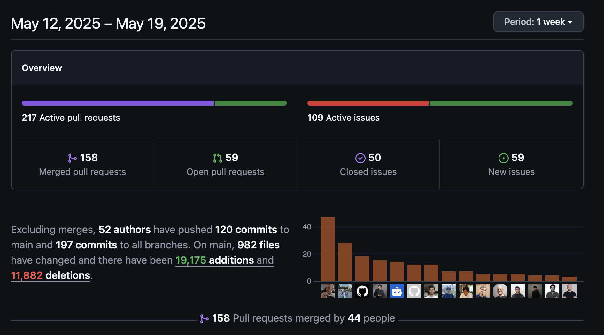

Apache Airflow 是一個大型開源專案  
一週就有**超過 100 個 Active PRs**  

> 
> Just a normal week in Apache Airflow !

這篇文章會透過參與 Apache Airflow 的經驗  
來分享我看到**大型軟體的演進過程**包括:

- 軟體是如何長大
- 管理 Codebase 
- 持續整合
- 發行


## 軟體是如何長大

### Improvement Proposal / Design Document

https://cwiki.apache.org/confluence/display/AIRFLOW/Airflow+Improvement+Proposals

https://github.com/orgs/apache/projects/415/views/1

### Issues / Tickets


## 管理 Codebase

### Monorepo vs Polyrepo

隨著軟體專案規模的增長，如何組織程式碼庫成為了一個關鍵問題。目前業界主要有兩種程式碼庫架構模式：**Monorepo** (單一程式碼庫) 和 **Polyrepo** (多程式碼庫)。讓我們深入探討這兩種架構的差異、優缺點，以及 Apache Airflow 如何運用這些概念。

#### Monorepo (單一程式碼庫)

**Monorepo** 是將所有相關專案的程式碼存放在同一個版本控制儲存庫中的策略。

##### 主要特點
- **統一的版本控制**：所有程式碼在同一個儲存庫中，共享版本歷史
- **簡化依賴管理**：專案間的依賴關係更加透明
- **原子性變更**：可以同時變更多個專案，確保功能一致性
- **程式碼共享**：跨專案共享程式碼和工具變得更加容易
- **統一的 CI/CD 流程**：可以為所有專案設定一致的流程

##### 常見使用場景
- **Google**：所有程式碼都存放在單一巨大的儲存庫中
- **Facebook**：使用自定義的版本控制系統管理單一儲存庫
- **Microsoft**：Windows 和 Office 產品線各自使用巨大的 Monorepo
- **開源項目**：如 Babel、React、Angular 等

#### Polyrepo (多程式碼庫)

**Polyrepo** 是將不同專案或模組分開放置在不同版本控制儲存庫中的策略。

##### 主要特點
- **專案隔離**：每個專案獨立開發，有自己的版本控制歷史
- **獨立部署**：每個專案可以獨立發布和部署
- **權限管理**：可以針對不同專案設置不同的權限
- **技術多樣性**：不同專案可以使用不同的技術棧
- **更小的儲存庫**：每個儲存庫規模較小，克隆和操作更快

##### 常見使用場景
- **微服務架構**：每個微服務都有自己的儲存庫
- **第三方插件系統**：核心系統和擴充插件分開管理
- **開源項目**：如 Apache 基金會的各個專案

#### Apache Airflow 的程式碼庫架構

Apache Airflow 採用了**混合模式**的架構：

1. **核心部分採用 Monorepo**：
   - Airflow 核心功能
   - DAG 定義和排程機制
   - Web UI 和 CLI 介面
   - 基本運算子和鉤子
   
2. **Providers 採用 Semi-Polyrepo**：
   - Providers 是連接各種外部系統的連接器和運算子集合
   - 雖然在同一個儲存庫中，但具有獨立的發布週期
   - 可以單獨安裝和升級，如 `apache-airflow-providers-google`

```
airflow/
├── api/                  # REST API 相關程式碼
├── cli/                  # 命令列工具
├── contrib/              # 社群貢獻的功能 (已棄用)
├── example_dags/         # 範例 DAG
├── executors/            # 執行器實作
├── providers/            # 各種服務供應商的整合
│   ├── amazon/           # AWS 服務整合
│   ├── google/           # Google Cloud 服務整合
│   ├── microsoft/        # Azure 服務整合
│   └── ...
├── models/               # 資料模型定義
├── operators/            # 核心運算子
├── sensors/              # 核心感應器
├── utils/                # 公用工具
└── www/                  # Web UI
```

#### Airflow Providers 系統

Airflow 2.0 後引入的 Providers 系統是一個關鍵設計，展現了從 Monorepo 向 Polyrepo 特性的轉變：

1. **獨立版本控制**：每個 Provider 包有獨立的版本號
2. **獨立發布週期**：不同 Provider 可以按需發布，不需等待核心版本發布
3. **減輕依賴問題**：用戶只需安裝所需的 Provider，避免不必要的依賴
4. **技術解耦**：Provider 可以使用特定於其服務的技術和庫
5. **社群參與**：降低貢獻門檻，專注於特定集成

例如，用戶可以單獨安裝 Amazon Provider：
```bash
pip install apache-airflow-providers-amazon==7.3.0
```

#### 選擇適當的架構

在選擇 Monorepo 還是 Polyrepo 時，需要考慮以下因素：

1. **團隊規模和組織結構**
   - 大型團隊通常偏好 Polyrepo，便於權限管理
   - 小型團隊可能偏好 Monorepo，簡化協作流程

2. **專案複雜度和相互依賴性**
   - 高度相關的專案更適合 Monorepo
   - 獨立性強的專案更適合 Polyrepo

3. **發布週期**
   - 同步發布的專案適合 Monorepo
   - 獨立發布的專案適合 Polyrepo

4. **工具支援**
   - 考慮版本控制系統、CI/CD 工具對大型儲存庫的支援能力

5. **擴展性需求**
   - 大規模 Monorepo 需要專用工具支援 (如 Bazel, Buck)
   - Polyrepo 在原生工具下擴展性較好

#### 混合架構：當前趨勢

現代軟體開發中，越來越多的團隊採用混合架構：

- **核心系統**：採用 Monorepo 管理核心功能和共享程式碼
- **擴充功能**：採用 Polyrepo 管理擴充模組和插件
- **套件管理**：使用套件管理系統連接不同儲存庫的程式碼

這種混合模式既能享受 Monorepo 的協作優勢，又能獲得 Polyrepo 的獨立性和擴展性，適合复雜的大型系統。

Apache Airflow 通過其核心 + Providers 的架構，很好地實踐了這種混合模式，既保持了核心系統的一致性，又讓各種外部系統的整合能夠獨立發展。


### 什麼時候才需要切新的 module?

### SOLID 和 Clean Architecture 是必要的嗎？

https://www.explainthis.io/zh-hant/swe/solid

### 軟體設計原則


## 持續整合 (Continuous Integration)


### CI 工具

Code Quality and Linting
Code must pass black, ruff, mypy, and pre-commit checks

Static analysis helps catch bugs early and ensures consistent style

### 測試 (Testing)

**為什麼測試屬於 CI 的一部分？**

當每天都有數十個 PR 被 merge 時  
要如何保證**每個 PR 都**
- 對 A Feature 的修改不會影響到 B Feature 
- 整體功能不會因為這個 PR 而壞掉
- 整體效能不會因為這個 PR 而變差
- ... 

這時候**盡可能完整、穩健的測試**就可以盡量避免以上問題發生 
所有的 PR 都需要通過 CI 測試才能被 merge，就可以**進一步保證系統的穩定性**

**怎樣算是完整的、穩健測試？**

大型軟體的測試必須包括**單元測試、整合測試、端對端測試**等不同層級的測試
- **單元測試（Unit Testing）**
  - 測試**單個函數或模組**的行為，通常使用 Mock 物件來隔離測試對象
- **整合測試（Integration Testing）**
  - 測試多個模組或系統之間的互動，通常需要實際的資料庫或外部服務
- **端對端測試（End-to-End Testing）**
  - 測試整個系統的工作流程，通常會搭配 User Story 來驗證系統的功能
  - 以 Airflow 來說，是用 **系統測試**（System Testing）來測試整個 Airflow 的工作流程
  - 不過可以把 E2E 和 系統測試當作同一個層級

**一個好的 PR: 測試應該會比 Product 的改動還要多**

以測試覆蓋率(Test Coverage)來說:  
一個 `if` 也代表 2 個 branch 也就是 2 個 case  
如果這個 PR 有改到 Product  
那就應該要補所有 case 相對應的測試

以我[第一個 PR #42902](https://github.com/apache/airflow/pull/42902/files) 為例:  

實際 Product 的改動**只有一行**  
但是卻花 20 幾個討論還有多個 test case 和 mock 把單元測試寫好  


> 一個比較好的 PR 例子是
> test code是product code好幾倍長  
> code沒有測試，到production才炸掉真的很煩  
> [Reference from JC Tech](https://www.facebook.com/share/p/15pSudbSPq/)


### Onboard 新的開發者 (Contributor Onboarding)

## 發行 (Release)

### 語義化版本控制 (Semantic Versioning)

語義化版本控制（Semantic Versioning，簡稱 SemVer）是一種給軟體版本編號的規範，目的是讓開發者能夠清楚地傳達每次發行的變更影響程度，同時也讓使用者能夠理解升級時可能面臨的風險。

#### SemVer 的基本格式

SemVer 的版本號由三個部分組成：`主版本號.次版本號.修訂號`（MAJOR.MINOR.PATCH）

- **主版本號（MAJOR）**：當你做了不兼容的 API 修改時遞增
- **次版本號（MINOR）**：當你做了向下兼容的功能性新增時遞增
- **修訂號（PATCH）**：當你做了向下兼容的問題修正時遞增

此外，還可能有額外的標籤，如預發行版本標籤（alpha、beta、rc）和構建元數據。

例如：`2.3.1`、`1.0.0-alpha`、`3.4.2-beta.2`

#### 實際應用案例

讓我們看看 Apache Airflow 如何運用語義化版本控制：

- Airflow `1.10.15` → `2.0.0`：主版本號的變更，表示有不兼容的 API 修改
- Airflow `2.0.0` → `2.1.0`：次版本號的變更，表示有新功能但保持向下兼容
- Airflow `2.1.0` → `2.1.1`：修訂號的變更，表示修復了 bug 但保持向下兼容

#### Python 中的版本管理範例

在 Python 生態系統中，我們可以透過 `setup.py` 或 `pyproject.toml` 來定義套件的版本號，並透過相依性管理工具（如 pip、poetry）來指定相依套件的版本範圍。

**使用 setup.py 定義版本：**

```python
# setup.py
from setuptools import setup

setup(
    name="my-package",
    version="1.2.3",
    # 其他設定...
)
```

**使用 pyproject.toml 定義版本（Poetry）：**

```toml
[tool.poetry]
name = "my-package"
version = "1.2.3"
# 其他設定...
```

**在 requirements.txt 中指定相依性版本範圍：**

```
# requirements.txt
requests>=2.25.0,<3.0.0  # 接受 2.25.0 及以上的 2.x 版本
flask==2.0.1             # 嚴格指定 2.0.1 版本
pandas~=1.3.0            # 接受 1.3.x 版本，但不接受 1.4.0 及以上
```

**在程式中檢查版本兼容性：**

```python
import pkg_resources
from packaging import version

# 檢查已安裝套件的版本
installed_version = pkg_resources.get_distribution("requests").version
print(f"Installed requests version: {installed_version}")

# 版本比較
if version.parse(installed_version) < version.parse("2.20.0"):
    print("Warning: Using an outdated version with security vulnerabilities")
elif version.parse(installed_version) >= version.parse("3.0.0"):
    print("Warning: Using a major version that might have breaking changes")
```

**在 Apache Airflow 中處理相依性版本衝突：**

```python
try:
    import numpy as np
except ImportError:
    raise ImportError(
        "This module requires numpy. "
        "Please install it with: pip install 'numpy>=1.20.0,<2.0.0'"
    )

# 檢查版本是否符合要求
import numpy as np
from packaging import version

if version.parse(np.__version__) < version.parse("1.20.0"):
    raise ImportError(
        f"Found numpy version {np.__version__}, but this module "
        f"requires version 1.20.0 or higher. Please upgrade."
    )
```

#### 版本指定的最佳實踐

1. **鎖定小版本，開放修訂版本**：`package>=2.1.0,<2.2.0`
2. **使用波浪號運算符**：`package~=2.1.0`（等同於 `>=2.1.0,<2.2.0`）
3. **明確指定相依範圍**：避免使用 `*` 或不指定版本範圍

正確的版本管理不僅能提高軟體的可靠性，還能減少"相依地獄"（Dependency Hell）的問題，讓使用者可以安全地更新套件。

### 管理 Branch

因為 Airflow 是一個大型開源專案  
一週就有**超過 100 個 Active PRs**  

> 
> Just a normal week in Apache Airflow !

所以沒有完全按照 Git Flow 來管理 Branch  
但**概念是相似的**

- **main**:
  - 當前開發新 Feature 的branch
  - 會在 main 上開發下一個 Major 或 Minor 版本的 Feature
- **vX-Y-stable**:
  - `X` Major `Y` Minor 版本的 **release branch**
  - 會從 `vX-Y-test` merge 到 `vX-Y-stable` branch 再 release
- **vX-Y-test**:
  - `X` Major `Y` Minor 版本在 release 後的 Patch 版本 branch
  - 畢竟 release 後不可能完全沒有 bug
  - 所以之後針對 `X` Major `Y` Minor 版本的 bug fix 都會 merged 到 `vX-Y-test` branch


<div style="width:600px; transform: scale(0.8); transform-origin: top left;">



gitGraph
   commit id: "Start"
   commit id: "Feature A"
   commit id: "Feature B"
   commit id: "Feature C"

   branch v2-10-stable
   checkout v2-10-stable
   commit id: "2.10.0 Release" tag:"2.10.0"

   branch v2-10-test
   checkout v2-10-test
   commit id: "Bugfix 1 for 2.10"
   commit id: "Bugfix 2 for 2.10"

   checkout v2-10-stable
   merge v2-10-test id: "2.10.1 Release" tag:"2.10.1"

   checkout main
   commit id: "Feature D"
   commit id: "Bugfix for API(main)"

   checkout main
   commit id: "Feature E"

   branch v3-0-stable
   checkout v3-0-stable
   commit id: "3.0.0 Release" tag:"3.0.0"

   branch v3-0-test
   checkout v3-0-test
   commit id: "Bugfix 1 for 3.0"

   checkout v2-10-test
   commit id: "Bugfix for API(v2-10-test)"

   checkout v2-10-stable
   merge v2-10-test id: "2.10.2 Release" tag:"2.10.2"

   checkout v3-0-stable
   merge v3-0-test id: "3.0.1 Release" tag:"3.0.1"

   checkout main
   commit id: "Feature F"




</div>

**現在實際的例子:**

目前 Airflow 剛 release `3.0.1`  
所以現在 `main` branch 在做的 feature 其實都是 `3.1.0` 的 feature  

如果我用 `2.8.3` 的 Airflow 遇到 bug  
在 GitHub 的 `main` branch 去 trace bug 有高機率是找不到相對應的 traceback code 的  
> 搭配上一節提的語意化版本控制  
> 以這個例子已經差了一個**MAJOR**了  
> 所以應該去看 `v2-8-test` branch 的 code  


### 向後移植 (Backporting)

那如果我在 `main` branch 修的 `bug`  
發現 `X.Y.Z` 的版本也有同個 bug  
那該如何解決呢？  

這時候就會提到**向後移植（Backporting）**
就只是把現在對 `main` branch 的 bug fix **也發一個 PR 到下一個 `X.Y.Z` Patch Release 的 branch** 
以 Airflow 來說就是 `vX-Y-test` branch 


**如何進行向後移植？**

1. **由 CI 自動化 Cherry-pick**
  - 適用於**branch 之間的差異不大**
  - **例如:**
    - 最近剛 release 的 `3.0.1` 版本，如果 `main` branch 有 bug fix 的 PR
    - 都會直接加 [backport-to-v3-0-test](https://github.com/apache/airflow/pulls?q=is%3Apr+backport+is%3Aclosed+label%3Abackport-to-v3-0-test) 的 label
      - 當實際 PR 被 merge 後
      - GitHub Action 會自動再發一個 cherry-pick PR 到 `v3-0-test` branch
    - 當遇到 conflict 時
      - 再人工處理
2. **人工發 Backport PR**
  - 適用於**branch 之間的差異很大**
    - 以 Airflow 來說會差**數千個 commits**
    - [`v2-11-test` branch](https://github.com/apache/airflow/tree/v2-11-test)
  - **例如:**
    - 為了修 `2.10.3` 的 bug
    - 也發現 `main` branch 也有同個 bug 
    - 因為差了**數千個 commits**所以還是就要人工發一個 Backport PR


**大部分會提到 Backport 的情境都是:**

新的貢獻者用 `X.Y.Z` 的版本遇到 bug  
但也不知道上一節所提的 Airflow branch 管理方式 

就直接 clone `main` branch 的 code  
也剛好 `main` 也有這個 bug，所以順手發了 PR  
這時候就會有 Airflow 的 maintainer 來提醒貢獻者可以**再順手發一個 Backport PR**  
才是真的有修到 `X.Y.Z` 的 bug  

### 第三方套件的 Release (Providers Release)

很特別的是  
Airflow 的 Providers 都是從 `main` branch 來 release  
所以不會有同時維護兩個 Major 版本的情況  

### 里程碑 (Milestone)

### 軟體發行週期 (Software Release Life Cycle)

https://zh.wikipedia.org/zh-tw/%E8%BB%9F%E4%BB%B6%E7%89%88%E6%9C%AC%E9%80%B1%E6%9C%9F

### RM (Release Manager)

## 向後相容性 (Backward Compatibility)

compatible interface

## 結論


## References

- [distribution-vs-release in madarian](https://breezymove.blogspot.com/2017/03/distribution-vs-release.html)