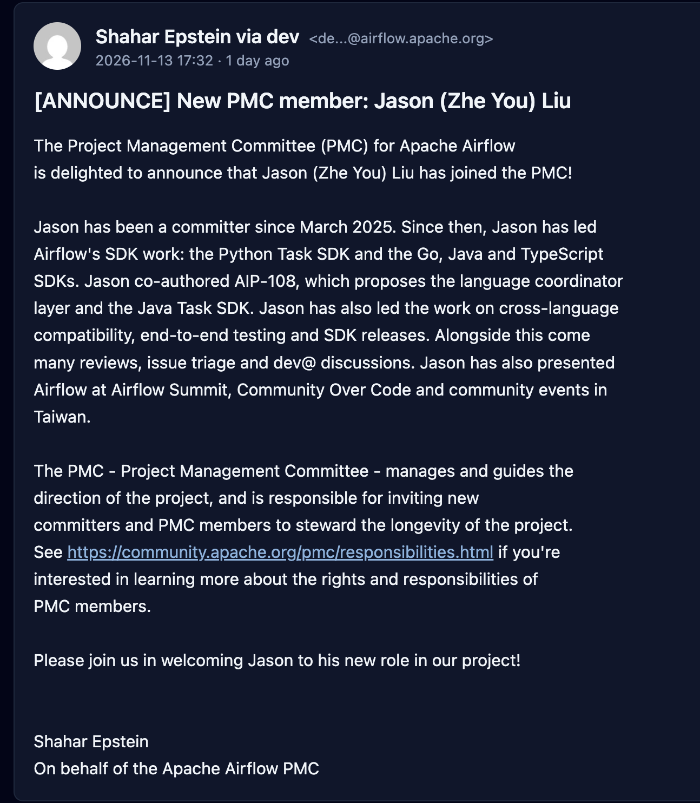
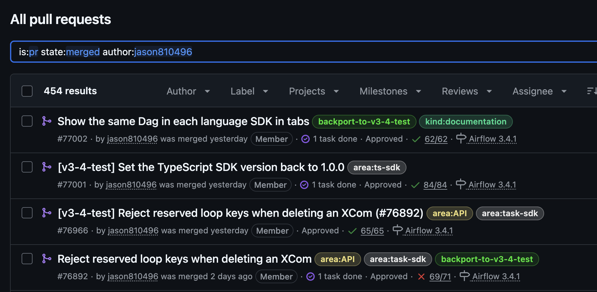
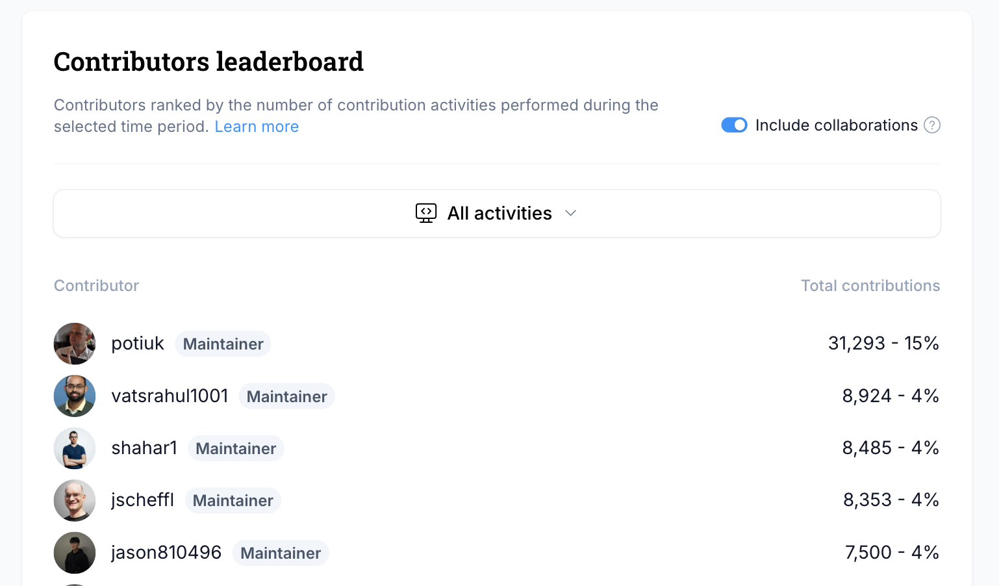
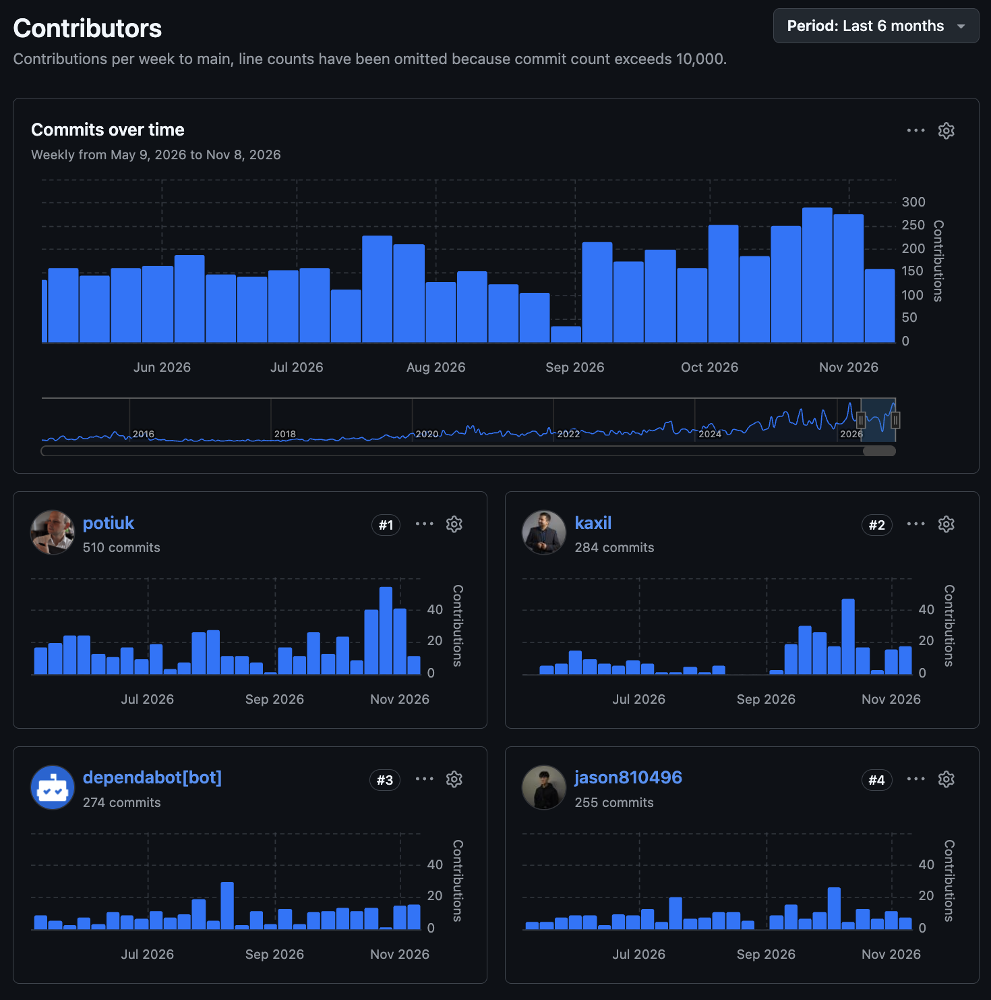
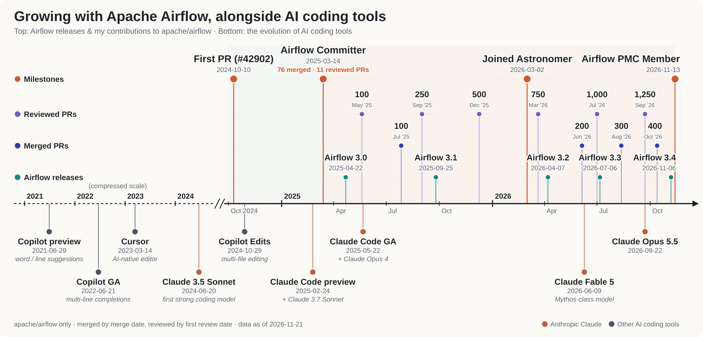
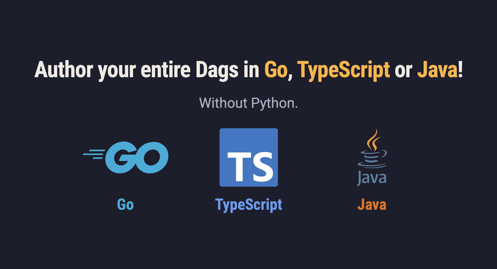
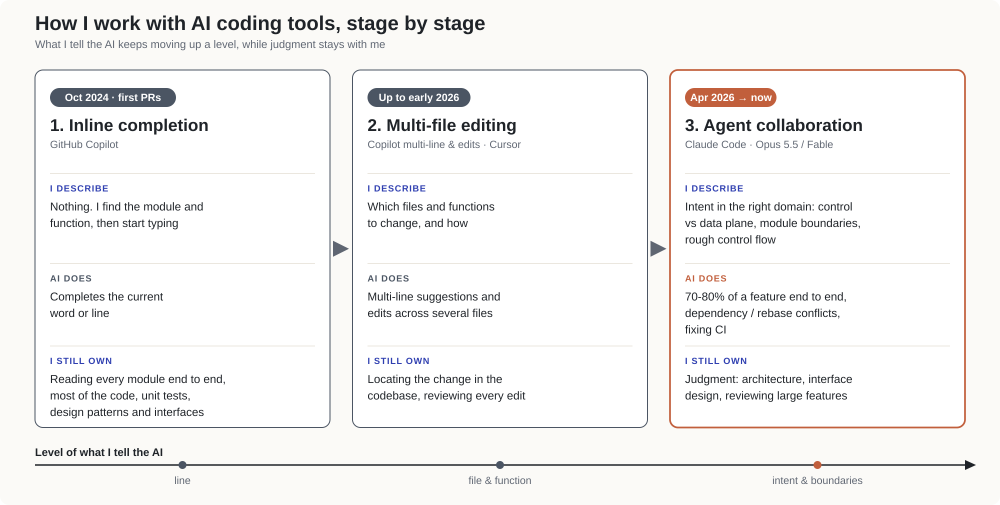
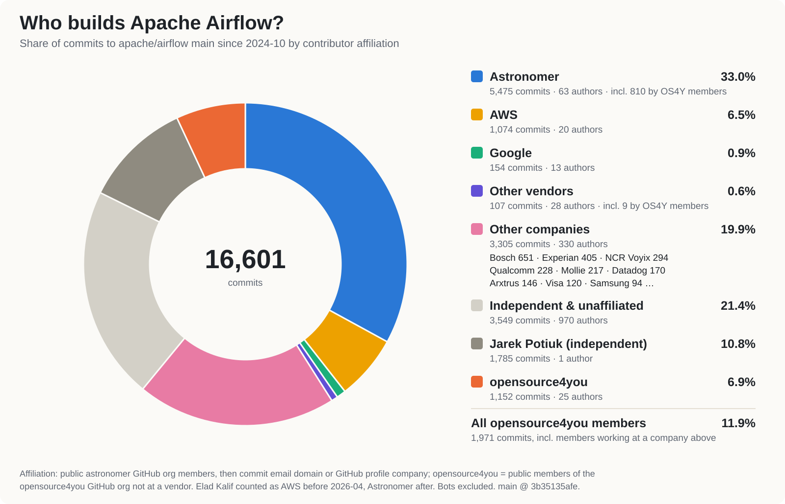

## Background

I'm [Zhe-You Liu (Jason)](https://github.com/jason810496), a Software Engineer on the Airflow OSS Team at [Astronomer](https://www.astronomer.io/).
I focus on open source contribution, and I'm interested in distributed systems and data engineering.

If you want to know:
- **What I got out of contributing to open source**
- **Why Apache Airflow?**
- **How to start contributing to Apache Airflow?**
- **How to find issues to work on?**
- **How to write a PR?**

Take a look at the post I wrote last year:



About one year and eight months after becoming a Committer last March,
**I officially became an Apache Airflow PMC member on November 13, 2026!**

> 
> [[ANNOUNCE] New PMC member: Jason (Zhe You) Liu](https://lists.apache.org/thread.html/8n7xlg0hmlmbb7owkq9hom6j151sp8zv)

## Some contribution stats

As of the day I joined the PMC, I have [454 merged PRs](https://github.com/apache/airflow/pulls?q=is%3Apr+author%3Ajason810496+is%3Amerged+merged%3A%3C%3D2026-11-13) in apache/airflow and have reviewed [1,362 PRs from other people](https://github.com/apache/airflow/pulls?q=is%3Apr+reviewed-by%3Ajason810496+-author%3Ajason810496+created%3A%3C%3D2026-11-13).
That's three times as many reviews as merged PRs.

The LFX Insights Contributors leaderboard covers the past 365 days and also counts collaboration such as reviews and comments.
I'm currently fifth. The four people ahead of me are all long-time Airflow PMC members.

Over the last six months (May 9 to Nov 8, 2026), I'm fourth by commits to the main branch, with 255 commits.

## Contribution is more than opening PRs

**Code review**

Opening a PR costs very little now, but the time a person needs to validate the architecture hasn't shrunk.
AI can help with code review, of course. I still read the PR myself first to catch architectural problems or things that need clarifying, then let AI go over the implementation details.

**Joining dev list discussions**

The [dev list](https://lists.apache.org/list.html?dev@airflow.apache.org) has always been where you get visibility and where the community learns that you exist.
I took part in discussions there even before becoming a Committer. Ironically, in the half year since I started this job, I've been so focused on designing and building the Language SDKs that I haven't had time to read every other thread.

**Opening issues**

When I see the same pattern that needs fixing in many places, I open a meta issue and track it. Instead of fixing everything myself, it scales out so other contributors can pick up the pieces.

**Dev calls and conferences**

Whether it's Airflow Summit or CommunityOverCode, in-person events are where I get to talk face to face with people I've worked with for a long time. Talking in person feels closer than online, and there's more time for longer-term topics.

The online dev calls help too, but they lean toward progress updates and unblocking current work, so they aren't the place to cover many topics at once.

## What I started caring about after becoming a Committer and joining the OSS Team

**Why releases matter**

- The timeline of each feature planned for a release: it affects when users and stakeholders can test, and when the release goes out.
- Whether a feature makes it into this release or slips to the next cycle.
- How a large new feature fits the release management lifecycle: it affects compatibility across components, releases and features, and the long-term maintenance cost.

**What I look for in fix or improvement PRs**

- Is there a better mechanism that prevents the same regression from happening again, instead of a one-off fix?
- Does the PR make sense at the architecture level?
- Does it affect end-to-end behavior?
- Potential performance issues. For example, [Warn agents against loading the serialized Dag on hot paths #75932](https://github.com/apache/airflow/pull/75932) is an anti-pattern on the Airflow task execution hot path that I only learned about recently.
- Does it need a new interface, or a better one?
- How will a new interface affect future maintenance and compatibility?

**What CI/CD and testing are for**

- Effective automated tests, plus testing betas and RCs, to make sure a new release has no regressions. Every new feature should ship with integration and end-to-end tests on day one, so they become automated regression tests for future releases.
- Making sure human mistakes in operations don't happen again. For example, the [Add Milestone Tag Assistant #61626](https://github.com/apache/airflow/pull/61626) I added still shows up on every backport PR today.

## Growing with Airflow, alongside AI

### From Airflow 3.0 to the non-Python SDKs

My first PRs, and most of my time before becoming a Committer, went into the big refactor ahead of Airflow 3.0.
I worked on parts of the API server refactor and the design of the authorization interface.

Between becoming a Committer and joining Astronomer, after wrapping up the last 3.0 API server refactors, I mostly focused on code review and studying end-to-end paths.
I also worked on provider integration for event-driven scheduling (the Common MessageQueue interface), made Breeze k8s easier to use, improved Remote IO end to end, and improved Triggerer performance at scale.

In my eight months at Astronomer, I've mostly worked with [TP](https://github.com/uranusjr) on the non-Python SDKs. It started with the Java SDK. The Go SDK moved away from being driven by the Edge Worker to the coordinator interface, so it can now run on any Executor. Then came the community-driven TypeScript SDK, led by [Shivam](https://github.com/shivaam).
We then went further: you can now describe an entire Dag in those languages without any Python, which breaks the Python-only limit Airflow has had for the past ten years.

This gave me a chance to revisit what a Dag and a Task really are in Airflow.
I had to understand exactly how a Task is defined and the whole flow of how it gets executed before I could design write and read paths that every SDK can reuse.

The Language SDKs shipped as beta in Airflow 3.3.0, and each reached 1.0.0 with Airflow 3.4.0.
Many major features are still under discussion. Either way, I'm looking forward to the TypeScript, Go and Java SDKs reducing the fragmentation that orchestration frameworks get from being tied to the languages they support.

### From AI-assisted contributions to working with agents

When I started contributing, I mostly used the free GitHub Copilot for short inline suggestions.
I still had to walk through every module myself to understand the end-to-end path and find the exact module and function. Even with Copilot's suggestions, I'd say most of the code was written by hand.
Unit tests, design patterns and interface design all took a lot of effort back then.

Before I joined Astronomer, GitHub Copilot added multi-line suggestions and multi-file editing.
Early on at Astronomer I used Cursor, and only started using Claude Code around April this year.

Now, in the Opus 5.5 era, I no longer need to point at a specific function or module.
In the right domain, I only need to describe the intent and roughly what the feature should do: what belongs in the control plane and what belongs in the data plane, where the boundaries between modules are, and the rough control flow.
That gets the implementation 70 to 80 percent of the way there, or at least to a basic end-to-end feature.

Whether I'm designing a new feature, implementing part of one, or reviewing a PR, the most time-consuming and most valuable part is still judgment.
Good judgment still depends on understanding the whole system deeply over a long time.

For large features, even Fable still can't get it right in one pass the way I picture the flow.
These tools do take care of a lot of pure grunt work, like resolving dependency conflicts and rebase conflicts or fixing CI, which leaves me more time for architecture and interface design.

### Regular review and reflection

One practice on the OSS Team that I like is sending a daily report to a channel every day.
Each morning I can look back at what I did yesterday, check whether there's anything to prioritize today for this quarter's goals, and see whether teammates have PRs waiting for my review. It also saves the time of a standup meeting.

With these records, it's easy to look back on what I did over a quarter or a year and what impact it had, or to tidy up my skills and workflows.
Looking back at whether I thought deeply enough about the architecture, the end-to-end path and the trade-offs is how I currently practice judgment.

## Where it started: OpenSource4You

[OpenSource4You](https://github.com/opensource4you/readme/) is a non-profit that encourages people in Taiwan to contribute to large open source projects. The people who stick around either believe in open source or simply think contributing to big open source projects is cool.

This is where I first met [Chia-Ping Tsai](https://github.com/chia7712), who founded OpenSource4You, and [Wei Lee](https://github.com/Lee-W), the mentor of the Airflow channel at the time. That's how I've kept contributing ever since.

After becoming a Committer, I've tried to use my free time after work to share issues I come across, directions worth contributing to, and new features with the people involved.

People who have taken part: [Aaron Chen](https://github.com/aaron-y-chen), [Andrew Chang](https://github.com/Andrushika), [ccoliu](https://github.com/ccoliu), [Chao-Hung Wan](https://github.com/xchwan), [Chao-Ju Chen](https://github.com/ricky-chaoju), [ChenChen Lai](https://github.com/0lai0), [Cheng-Yi Shih](https://github.com/cool9850311), [ChickenBenny](https://github.com/ChickenBenny), [Doyeon Kim](https://github.com/dybyte), [Eric Chang](https://github.com/unknowntpo), [fweilun](https://github.com/fweilun), [Guan-Ming Chiu](https://github.com/guan404ming), [Henry Chen](https://github.com/henry3260), [Jyun-An Chen](https://github.com/ColtenOuO), [KUAN-HAO HUANG](https://github.com/rich7420), [Parker Chang](https://github.com/Parkerhiphop), [PoAn Yang](https://github.com/FrankYang0529), [rjgoyln](https://github.com/rjgoyln), [Vic Wen](https://github.com/viiccwen), [Vincent Hsiao](https://github.com/fat-catTW), [Wilson Josix Wang](https://github.com/josix), [Y-C](https://github.com/Eason09053360), [Ying-Fang](https://github.com/yjaw), [Yusin (Peter) Huang](https://github.com/Yusin0903), [Zhen-Lun (Kevin) Hong](https://github.com/kevinhongzl), [秀吉](https://github.com/thc1006)

PR counts don't directly reflect impact, but many of them have gone from fixing small bugs to paying down tech debt, joining technical discussions on the dev list, or proposing and building hidden gem features.

Apart from companies that offer Airflow as a service, OpenSource4You is one of the largest contributing organizations, and it has had a real impact on recent Airflow releases. Its members contributed many Language SDK features, found several blockers in the 3.4.0 RC, and were already part of the big 3.0 refactor.

## Airflow and the future

I'll keep focusing on the non-Python SDKs for now, but many community-driven AIPs (Airflow Improvement Proposals) are in the works.
They aim to solve users' pain points and give users more control over their workflows.

The [Common AI provider](https://airflow.apache.org/docs/apache-airflow-providers-common-ai/stable/index.html) for agentic workflows recently went GA, and it's still gaining new features.
Other AI frameworks are also starting to use Airflow as a durable execution option: [Pydantic AI](https://pydantic.dev/docs/ai/capabilities/durable_execution/airflow/) already supports it, and docs integration for the [OpenAI Agents SDK](https://github.com/openai/openai-agents-python/issues/6071) is in progress.

On project infrastructure, Jarek and Shahar are leading work to run CI on contributors' forks and to use RunsOn spot instances as CI runners.
A longer-term maintainer goal is to use Airflow itself to build triage, review and release workflows for maintainers, with the Common AI provider and Human-in-the-Loop features. That way we dogfood our own project and keep the maintainer and user roles connected.
There's also basic but important work on trusted releases: we're looking at Apache Trusted Releases (ATR), still in beta, to make package releases safer and less dependent on manual steps.

## Special thanks

To all the PMC members I've worked with: [Amogh Desai](https://github.com/amoghrajesh), [Ash Berlin-Taylor](https://github.com/ashb), [Brent Bovenzi](https://github.com/bbovenzi), [Buğra Öztürk](https://github.com/bugraoz93), [Daniel Standish](https://github.com/dstandish), [Elad Kalif](https://github.com/eladkal), [Ephraim Anierobi](https://github.com/ephraimbuddy), [Hussein Awala](https://github.com/hussein-awala), [Jarek Potiuk](https://github.com/potiuk), [Jed Cunningham](https://github.com/jedcunningham), [Jens Scheffler](https://github.com/jscheffl), [Kaxil Naik](https://github.com/kaxil), [Niko Oliveira](https://github.com/o-nikolas), [Pavan Kumar Gopidesu](https://github.com/gopidesupavan), [Pierre Jeambrun](https://github.com/pierrejeambrun), [Rahul Vats](https://github.com/vatsrahul1001), [Shahar Epstein](https://github.com/shahar1), [Tzu-ping Chung](https://github.com/uranusjr), [Vikram Koka](https://github.com/vikramkoka), [Vincent Beck](https://github.com/vincbeck), [Wei Lee](https://github.com/Lee-W), [Xiaodong Deng](https://github.com/XD-DENG)

Thank you all for your trust and encouragement.
Reading the nomination thread on the private list afterwards really moved me.

My manager, [Phani](https://github.com/phanikumv).

[Chia-Ping Tsai](https://github.com/chia7712), who founded OpenSource4You.

My family and my girlfriend, who have supported me all along.

> The views in this post are my own and do not represent my employer.

## Related links

- [**Airflow non-Python SDKs**](https://airflow.apache.org/docs/apache-airflow/stable/authoring-and-scheduling/language-sdks/index.html)
  - [TypeScript SDK Doc](https://airflow.apache.org/docs/apache-airflow/stable/authoring-and-scheduling/language-sdks/typescript.html), [TS-SDK API Reference](https://airflow.apache.org/docs/ts-sdk/stable/), [npm: @apache-airflow/ts-sdk](https://www.npmjs.com/package/@apache-airflow/ts-sdk)
  - [Go SDK Doc](https://airflow.apache.org/docs/apache-airflow/stable/authoring-and-scheduling/language-sdks/go.html), [pkg.go.dev: github.com/apache/airflow/go-sdk](https://pkg.go.dev/github.com/apache/airflow/go-sdk)
  - [Java SDK Doc](https://airflow.apache.org/docs/apache-airflow/stable/authoring-and-scheduling/language-sdks/java.html), [Maven Central: org.apache.airflow:airflow-sdk](https://central.sonatype.com/artifact/org.apache.airflow/airflow-sdk)
- **Agentic workflow in Airflow**
  - [Airflow Common AI provider](https://airflow.apache.org/docs/apache-airflow-providers-common-ai/stable/index.html)
  - [Airflow Registry - AI/ML](https://airflow.apache.org/registry/providers/?category=ai-ml)
  - [Pydantic AI - Durable Execution with Apache Airflow](https://pydantic.dev/docs/ai/capabilities/durable_execution/airflow/)
- [How to keep contribution quality when using AI tools (zh-tw)](https://github.com/opensource4you/readme/blob/main/articles/mindset-ai-assisted-contribution/README.md)
- [Join OpenSource4You Slack](https://github.com/opensource4you/readme/tree/main#%E5%BF%AB%E9%80%9F%E5%85%A5%E5%8F%A3)
