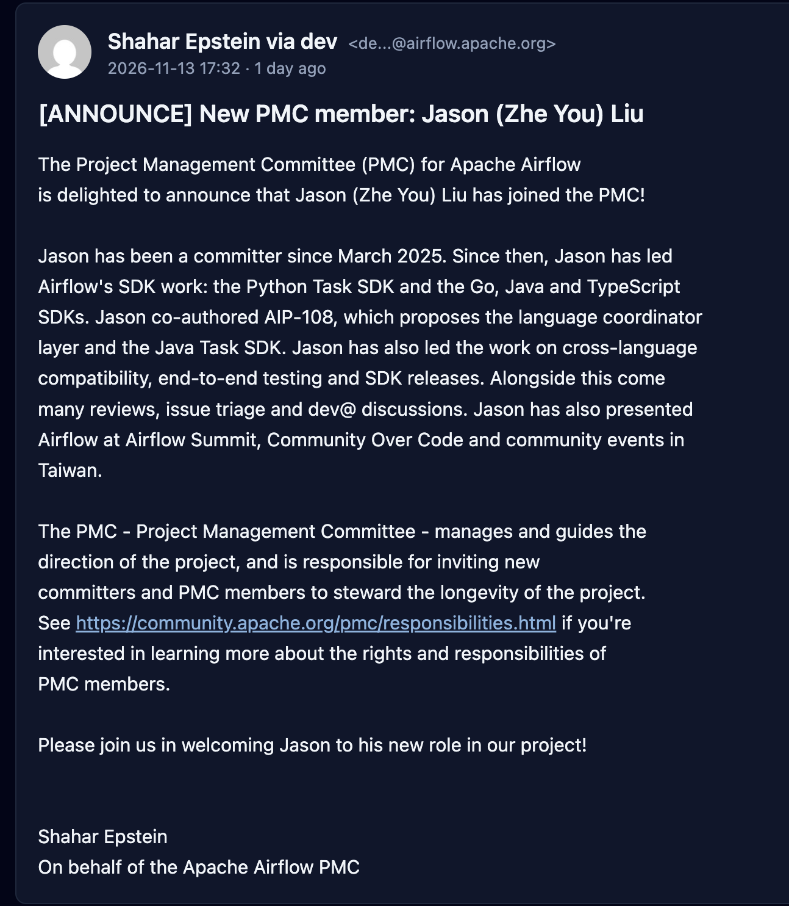
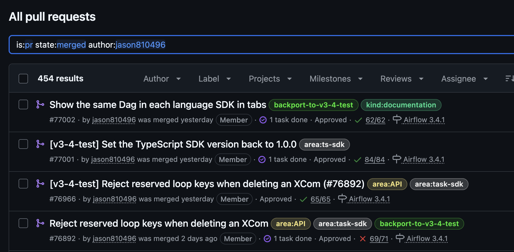
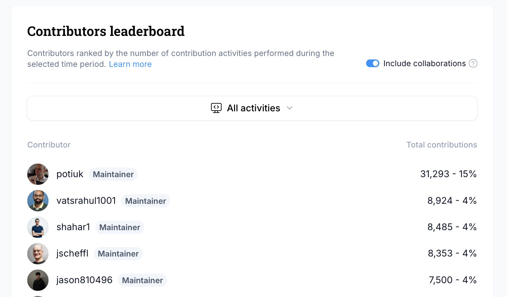
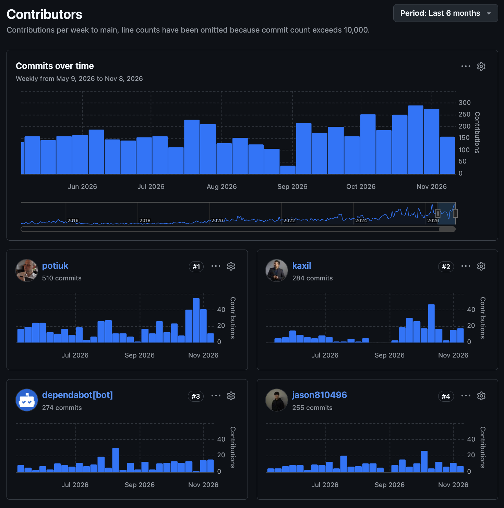
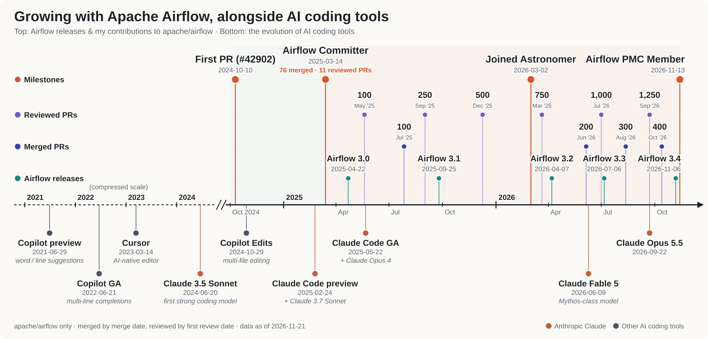
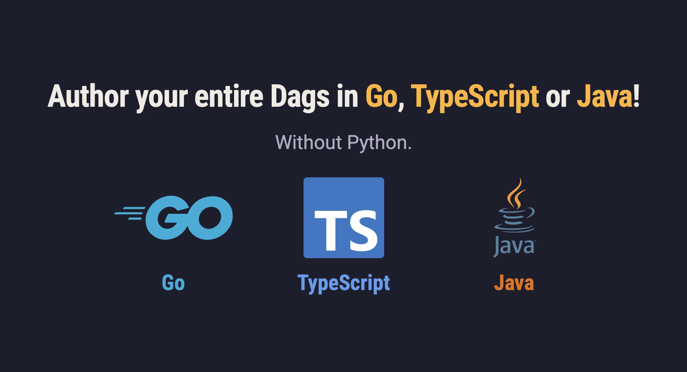
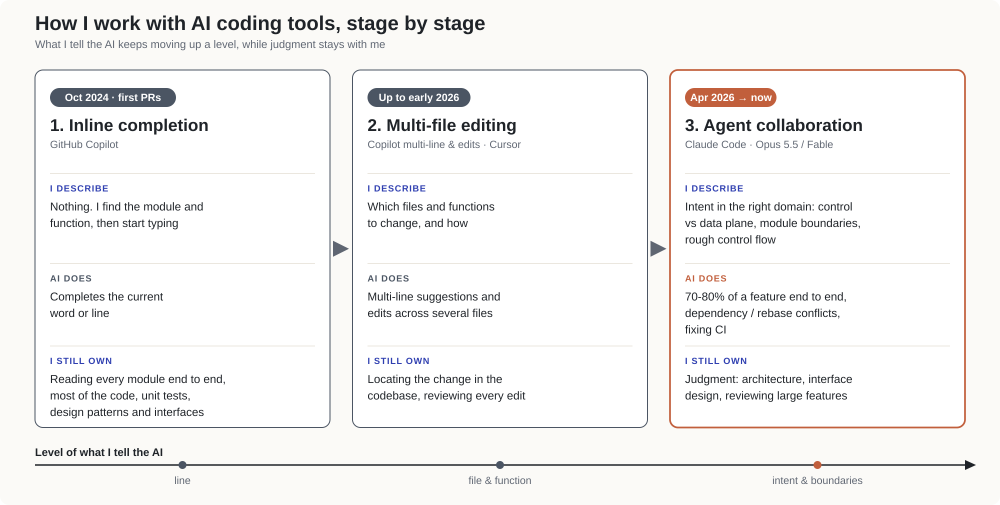
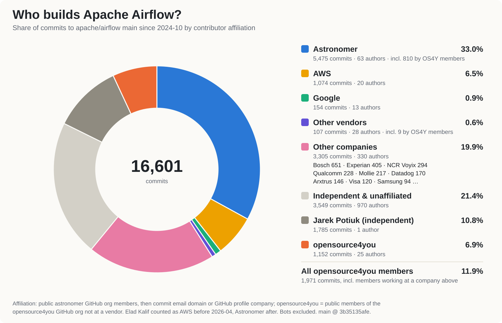

## 背景

我是[劉哲佑 (Jason)](https://github.com/jason810496)，目前在 [Astronomer](https://www.astronomer.io/) 的 Airflow OSS Team 擔任 Software Engineer  
專注在貢獻開源，對 Distributed System 和 Data Engineering 領域有興趣  

如果想了解：
- **參與開源貢獻的收穫**
- **為什麼選擇 Apache Airflow？**
- **如何開始貢獻 Apache Airflow？**
- **如何找 Issue 解？**
- **如何撰寫 PR？**

歡迎大家閱讀去年寫的文章



在去年三月拿到 [Committer](https://www.apache.org/foundation/how-it-works/#committers) 後，又過了約一年又八個月  
**在 2026 年 11 月 13 日正式拿到 [PMC member](https://www.apache.org/foundation/how-it-works/#pmc-members)！**

> 
> [[ANNOUNCE] New PMC member: Jason (Zhe You) Liu](https://lists.apache.org/thread.html/8n7xlg0hmlmbb7owkq9hom6j151sp8zv)

## 一些貢獻統計

到拿到 PMC 那天為止，我在 apache/airflow 一共有 [454 個 merged PR](https://github.com/apache/airflow/pulls?q=is%3Apr+author%3Ajason810496+is%3Amerged+merged%3A%3C%3D2026-11-13)，review 過 [1,362 個其他人的 PR](https://github.com/apache/airflow/pulls?q=is%3Apr+reviewed-by%3Ajason810496+-author%3Ajason810496+created%3A%3C%3D2026-11-13)  
review 的數量是 merged PR 的三倍。

[LFX Insights](https://insights.linuxfoundation.org/project/apache-airflow) 的 Contributors leaderboard 統計過去 365 天的活動，review、comment 這類 collaboration 也有算進去  
我目前排第五，前四位都是長期維護 Airflow 的 PMC members

最近半年（2026/5/9 到 11/8）main branch 的 commit 數是第四，共 255 個 commits  

## 但貢獻不只是發 PR

**Code review**

現在發一個 PR 的成本變得非常低  
但人為在驗證架構的時間並不會變快  
當然可以用 AI 幫忙 code review  
我目前還是會先人為看完抓出架構層面的缺失或需要釐清的地方  
再用 AI 掃過實作細節  

**參與 Dev list 討論**

[Dev list](https://lists.apache.org/list.html?dev@airflow.apache.org) 一直都是提升能見度，也讓社群知道「有這個人」的地方。從當 Committer 前就陸續有在上面參與討論，反而是工作後這半年都著重在 Language SDK 的設計與實作，比較沒時間看完其他的所有討論。

**開題目** 

看到多處有重複需要修的 pattern 開成 meta issue 並追蹤後續，從自己修變成 scale out 到讓其他貢獻者修。  

**參與 Dev call 和年會**  

無論是 [Airflow Summit](https://airflowsummit.org/) 還是 [CommunityOverCode](https://communityovercode.org/)，線下活動才有機會和長期一起合作的夥伴當面交流，當面聊也比線上親切，大家也有更多時間聊到更深遠的議題。

線上的 Dev call 當然也有幫助，不過性質偏向進度報告和解決當前的 blockers，不適合一次討論太多主題。

今年在格拉斯哥參加 CommunityOverCode EU 2026 和首屆 Airflow Contributor Day 的心得也整理在這篇



## 成為 Committer 與加入 OSS Team 後，開始在意的事

**Release 這件事情的重要性**

- 這個版本要進的各個 feature 的 timeline：會影響用戶與各個 stakeholders 的測試時程和正式發行日期
- 某個 feature 能不能趕上這個版本，還是要再晚一個週期
- 有新的大功能要如何考慮 [release management lifecycle](https://github.com/apache/airflow/blob/main/dev/README_RELEASE_AIRFLOW.md): 這會影響到不同元件、發布、功能這些之間的相容性還有長期的維護成本

**在有 Fix 或 Improvement 的 PR 會特別著重在**

- 有沒有更好的機制可以從頭預防相同的 regression 再次發生，而不是每次的單次修正
- 從整體架構層面思考該 PR 是否合理
- 是否會影響端對端的功能
- 潛在的效率問題，如：[Warn agents against loading the serialized Dag on hot paths #75932](https://github.com/apache/airflow/pull/75932) 也是近期才知道在 Airflow Task Execution 關鍵路徑上的 anti-pattern
- 是否需要新的介面或更好的介面
- 新介面對於後續維護、相容性的影響

**CI / CD 與測試的意義**
- 有效的自動化測試, testing beta, RC 來確保在新版本沒有 regression: 所有新開發的 feature 在 Day 1 就要加上相對應的整合測試與端對端測試，作為日後 release 的自動化 regression test
- 如何確保人為在 operation 的疏失不再發生：例如我之前引入的 [Add Milestone Tag Assistant #61626](https://github.com/apache/airflow/pull/61626) 到目前為止的所有 backport 相關 PR 都還會有它的身影

## 與 Airflow 共同成長和 AI 協作的歷史

### Airflow 3.0 到 non-Python SDK

最早的幾個 PR 與在當 Committer 前的時間都是在 [Airflow 3.0](https://airflow.apache.org/blog/airflow-three-point-oh-is-here/) 前的大 refactor  
有參與到 API server 的一些 refactor，以及 API server 與 [authorization 介面](https://airflow.apache.org/docs/apache-airflow/stable/core-concepts/auth-manager/index.html)相關的設計  

在成為 Committer 後到進入 Astronomer 前的這段期間   
在收尾最後 3.0 相關的 API server refactor 後主要都著重在 code review 和研究端對端路徑  
以及 [Event Driven Scheduling](https://airflow.apache.org/docs/apache-airflow/stable/authoring-and-scheduling/event-scheduling.html) ([Common MessageQueue interface](https://airflow.apache.org/docs/apache-airflow-providers-common-messaging/stable/index.html)) 的 provider 整合、提升 [Breeze](https://github.com/apache/airflow/blob/main/dev/breeze/doc/README.rst) k8s 的可用性、[Remote logging](https://airflow.apache.org/docs/apache-airflow/stable/administration-and-deployment/logging-monitoring/logging-tasks.html) 的端對端改善、[Triggerer](https://airflow.apache.org/docs/apache-airflow/stable/authoring-and-scheduling/deferring.html) 在擴展性的效能改善

在 Astronomer 的這八個月都主要與 [TP](https://github.com/uranusjr) 一起合作 [non-Python SDK](https://airflow.apache.org/docs/apache-airflow/stable/authoring-and-scheduling/language-sdks/index.html)，最一開始的 [Java SDK](https://airflow.apache.org/docs/apache-airflow/stable/authoring-and-scheduling/language-sdks/java.html)、捨棄由 [Edge Worker](https://airflow.apache.org/docs/apache-airflow-providers-edge3/stable/index.html) 驅動的 [Go SDK](https://airflow.apache.org/docs/apache-airflow/stable/authoring-and-scheduling/language-sdks/go.html) 變成現在由 [coordinator](https://airflow.apache.org/docs/task-sdk/stable/api.html) 介面驅動達到可以在不限 [Executor](https://airflow.apache.org/docs/apache-airflow/stable/core-concepts/executor/index.html) 執行的架構，到由社群驅動 ([Shivam](https://github.com/shivaam)) 的 [TypeScript SDK](https://airflow.apache.org/docs/apache-airflow/stable/authoring-and-scheduling/language-sdks/typescript.html)  
再進一步支援到不需要 Python 只用該程式語言就可以描述整個 Dag  
來打破 Airflow 過去十年都只能寫 Python 的限制  

所以有機會重新看一個 [Dag](https://airflow.apache.org/docs/apache-airflow/stable/core-concepts/dags.html)、[Task](https://airflow.apache.org/docs/apache-airflow/stable/core-concepts/tasks.html) 在 Airflow 的本質是什麼  
需要先了解具體一個 Task 如何被定義的、還有是如何被執行的整段流程  
才能設計出各個 SDK 都能重複利用的寫入和讀取路徑  

在 [Airflow 3.3.0](https://airflow.apache.org/docs/apache-airflow/3.3.0/release_notes.html) 有各個 Language SDK 發布 Beta 到 [Airflow 3.4.0](https://airflow.apache.org/docs/apache-airflow/3.4.0/release_notes.html) 時各個 Language SDK 1.0.0 正式發行。  
當然還有許多重大功能都還在討論階段  
無論如何，我非常期待 TypeScript, Go, Java SDK 能解決 orchestration framework 因為所支援的程式語言本身所造成的 fragmentation

### 使用 AI 貢獻到 Agent 協作時代

從最一開始貢獻都是使用免費的 [GitHub Copilot](https://github.com/features/copilot) 單字推薦為主  
還是需要親自走過所有 module 來了解端對端路徑後  
找到確切的模組、function，即使在 Copilot 的單字推薦輔助下，大部分的 code 應該還是可以說是親自寫的  
還有對於 unit test 和 design pattern、interface design 在當時都需要花許多心力琢磨  

在進 Astronomer 前 GitHub Copilot 有了多行推薦、到多檔案同時編輯  
在進去後的初期都是使用 [Cursor](https://cursor.com/) 直到大概今年四月左右才開始使用 [Claude Code](https://claude.com/product/claude-code)

當然演進到現在 [Opus 5.5](https://www.anthropic.com/claude/opus) 的時代  
現在也不用描述到 function 或是哪個 module  
只需要在正確的 domain 下專注在描述大致需要達成功能的想法及意圖  
描述哪些功能需要放在 control plane 那些功能需要放在 data plane  
表示各個模組之間的界線與大致的 control flow 就能寫到七、八成  
或是至少達成最基礎的端對端功能

現在無論是在設計新功能、實作部分功能本身、或是 review PR 最花時間也最有價值的還是「判斷」本身  
但如何有正確的判斷還是需要依靠長期對整個系統的充分理解  

以大 feature 來說，即使是 Fable  
到目前為止還是沒有辦法一次就寫得跟想像流程的一樣  
不過透過這些工具確實把很多單純花時間的苦功做完了  
例如單純花時間的解 dependency conflict, rebase conflict, 修 CI 等  
讓我有更多時間思考架構層面和設計介面的問題

### 定期回顧與反思

OSS Team 有一個我認為不錯的制度是每天需要傳 daily report 到某個頻道  
所以當天早上就可以重新檢視昨天的工作成果  
對於這季的目標今天有沒有要重視的目標  
其他一起合作的同事有沒有需要幫忙 review 的 PR  
也省去 standup meeting 的時間

有這些紀錄很容易定期回顧過去這一季、這一年做了什麼以及相對應的影響  
又或是定期整理 skills、工作流  
回頭看自己當時對架構、端對端路徑和 trade-off 想得夠不夠深  
是我目前用來練判斷的方法

## 貢獻開源的起點：OpenSource4You

[OpenSource4You](https://github.com/opensource4you/readme/) 是鼓勵台灣人實際貢獻大型開源軟體的非營利組織，長期參與的夥伴都是認同開源，或只是單純覺得貢獻大型開源軟體很帥就參與至今。

最一開始也是在這邊遇到創立 OpenSource4You 的 [Chia-Ping Tsai](https://github.com/chia7712)，和當時 Airflow 頻道的 Mentor [Wei Lee](https://github.com/Lee-W) 才一路貢獻至今  

在當上 Committer 後也盡量在下班有空的時候把看到的題目、值得貢獻的方向、最新的功能跟有參與的夥伴分享  

曾經有參與過的夥伴們：[Aaron Chen](https://github.com/aaron-y-chen), [Andrew Chang](https://github.com/Andrushika), [ccoliu](https://github.com/ccoliu), [Chao-Hung Wan](https://github.com/xchwan), [Chao-Ju Chen](https://github.com/ricky-chaoju), [ChenChen Lai](https://github.com/0lai0), [Cheng-Yi Shih](https://github.com/cool9850311), [ChickenBenny](https://github.com/ChickenBenny), [Doyeon Kim](https://github.com/dybyte), [Eric Chang](https://github.com/unknowntpo), [fweilun](https://github.com/fweilun), [Guan-Ming Chiu](https://github.com/guan404ming), [Henry Chen](https://github.com/henry3260), [Jyun-An Chen](https://github.com/ColtenOuO), [KUAN-HAO HUANG](https://github.com/rich7420), [Parker Chang](https://github.com/Parkerhiphop), [PoAn Yang](https://github.com/FrankYang0529), [rjgoyln](https://github.com/rjgoyln), [Vic Wen](https://github.com/viiccwen), [Vincent Hsiao](https://github.com/fat-catTW), [Wilson Josix Wang](https://github.com/josix), [Y-C](https://github.com/Eason09053360), [Ying-Fang](https://github.com/yjaw), [Yusin (Peter) Huang](https://github.com/Yusin0903), [Zhen-Lun (Kevin) Hong](https://github.com/kevinhongzl), [秀吉](https://github.com/thc1006)

PR 數量雖然不能代表直接的影響力，不過許多夥伴已經從修小 bug，進展到處理技術債、在 dev list 參與技術討論，或提出並實作 hidden gem feature。

可以說是除了以 Airflow 提供服務的公司以外貢獻最多的組織之一，也在 Airflow 近期的發布有重大的影響力，如：貢獻許多 Language SDK 相關功能也在 3.4.0 RC 找出多個 blockers 又或是更早期 3.0 大重構就有大家的身影。

## Airflow 與未來

雖然近期我都會著重在 non-Python SDK 的發展  
但目前還有許多由社群驅動的 [AIP (Airflow Improvement Proposal)](https://cwiki.apache.org/confluence/spaces/AIRFLOW/pages/89066602/AIP+-+Airflow+Improvement+Proposals) 在醞釀  
希望能解決用戶們的痛點也讓用戶更好控制 workflow  

與 agentic workflow 相關的 [Common AI provider](https://airflow.apache.org/docs/apache-airflow-providers-common-ai/stable/index.html) 也在近期正式 GA，目前還在持續擴展新功能  
其他 AI 框架也開始把 Airflow 當作 durable execution 的選項，例如 [Pydantic AI](https://pydantic.dev/docs/ai/capabilities/durable_execution/airflow/) 已經支援，[OpenAI Agents SDK](https://github.com/openai/openai-agents-python/issues/6071) 的文件整合也在進行中  

在 Project Infra 本身  
現在主要由 Jarek 和 Shahar 推動在 contributor 的 fork 跑 CI 還有使用 [RunsOn](https://runs-on.com/) 的 spot instances 當 CI runners  
或是更長遠的 maintainer 目標: 用 Airflow 本身來建立給 maintainer 的 triage, review, release workflow 使用 Common AI provider 和 [Human In The Loop](https://airflow.apache.org/docs/apache-airflow-providers-standard/stable/operators/hitl.html) 功能等，同時 dogfooding 我們自己，不讓維護者與使用者的角色脫鉤。  
又或是一些基本但重要的 trust release，研究目前還在 beta 的 [Apache Trusted Releases (ATR)](https://github.com/apache/tooling-trusted-releases) 讓整個 package release 更安全也更少人為介入。

## 特別感謝

所有我有合作過的 PMC members 們：[Amogh Desai](https://github.com/amoghrajesh), [Ash Berlin-Taylor](https://github.com/ashb), [Brent Bovenzi](https://github.com/bbovenzi), [Buğra Öztürk](https://github.com/bugraoz93), [Daniel Standish](https://github.com/dstandish), [Elad Kalif](https://github.com/eladkal), [Ephraim Anierobi](https://github.com/ephraimbuddy), [Hussein Awala](https://github.com/hussein-awala), [Jarek Potiuk](https://github.com/potiuk), [Jed Cunningham](https://github.com/jedcunningham), [Jens Scheffler](https://github.com/jscheffl), [Kaxil Naik](https://github.com/kaxil), [Niko Oliveira](https://github.com/o-nikolas), [Pavan Kumar Gopidesu](https://github.com/gopidesupavan), [Pierre Jeambrun](https://github.com/pierrejeambrun), [Rahul Vats](https://github.com/vatsrahul1001), [Shahar Epstein](https://github.com/shahar1), [Tzu-ping Chung](https://github.com/uranusjr), [Vikram Koka](https://github.com/vikramkoka), [Vincent Beck](https://github.com/vincbeck), [Wei Lee](https://github.com/Lee-W), [Xiaodong Deng](https://github.com/XD-DENG)

感謝大家一直以來的信任與鼓勵  
回去看 private list 的提名討論串後真的非常感動

我的主管 [Phani](https://github.com/phanikumv)

建立 OpenSource4You 的 [Chia-Ping Tsai](https://github.com/chia7712)

在一路上支持我的家人們和女友

> 本篇以上觀點屬於個人立場不代表公司立場

## 相關連結

- [**Airflow non-Python SDKs**](https://airflow.apache.org/docs/apache-airflow/stable/authoring-and-scheduling/language-sdks/index.html)
  - [TypeScript SDK Doc](https://airflow.apache.org/docs/apache-airflow/stable/authoring-and-scheduling/language-sdks/typescript.html), [TypeScript SDK API Reference](https://airflow.apache.org/docs/ts-sdk/stable/), [npm: @apache-airflow/ts-sdk](https://www.npmjs.com/package/@apache-airflow/ts-sdk)
  - [Go SDK Doc](https://airflow.apache.org/docs/apache-airflow/stable/authoring-and-scheduling/language-sdks/go.html), [Go SDK API Reference (pkg.go.dev)](https://pkg.go.dev/github.com/apache/airflow/go-sdk)
  - [Java SDK Doc](https://airflow.apache.org/docs/apache-airflow/stable/authoring-and-scheduling/language-sdks/java.html), [Java SDK API Reference](https://airflow.apache.org/docs/java-sdk/stable/), [Maven Central: org.apache.airflow:airflow-sdk](https://central.sonatype.com/artifact/org.apache.airflow/airflow-sdk)
- **Agentic workflow in Airflow**
  - [Airflow Common AI provider](https://airflow.apache.org/docs/apache-airflow-providers-common-ai/stable/index.html)
  - [Airflow Registry - AI/ML](https://airflow.apache.org/registry/providers/?category=ai-ml)
  - [Pydantic AI - Durable Execution with Apache Airflow](https://pydantic.dev/docs/ai/capabilities/durable_execution/airflow/)
- [使用 AI 工具時如何維持貢獻品質](https://github.com/opensource4you/readme/blob/main/articles/mindset-ai-assisted-contribution/README.md)
- [Join OpenSource4You Slack](https://github.com/opensource4you/readme/tree/main#%E5%BF%AB%E9%80%9F%E5%85%A5%E5%8F%A3)
